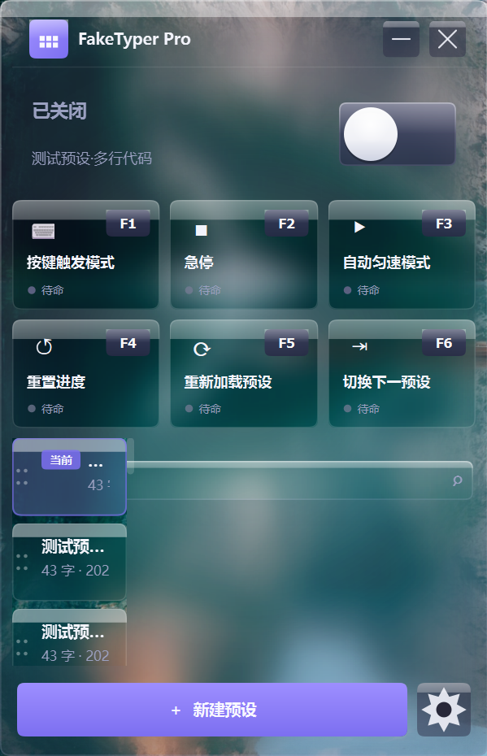

# FakeTyper Pro

[](LICENSE)
[](https://github.com/yizuiningchang/FakeTyper/releases)
[](requirements.txt)

> **一句话**：把预先准备好的代码或文案，用拟人化的打字节奏逐字输出到任意输入框，
> 让录课、直播、演示里的内容看起来是现场手敲出来的。

一个 Windows 桌面端的**伪装打字 / 自动输入工具**。录制教学视频、演示 demo、直播写代码时，
你可以提前把要展示的内容存成预设，运行时软件按真实打字节奏（含随机抖动、标点停顿、偶尔的思考停顿）
逐字"敲"进当前光标位置——不用背稿、不会打错、不会卡壳，也不需要剪辑加速。

**关键词**：伪装打字、自动打字、模拟键盘输入、自动输入文字、录课工具、演示录制、代码演示、
打字动画、auto typer、fake typing、typing simulator、keyboard automation、pyautogui 替代方案

## 版本状态

- **本仓库为 v1.0.0**：功能完整可用，但**界面层已停止演进**（自绘液态玻璃 UI 存在文字可读性问题），
  保留作为项目起点与经验记录。
- 打字引擎、数据层、打包链路质量可靠，v2 将复用这些部分、用 Qt 原生控件重写界面。

## 界面预览



---

## 技术栈

| 层面 | 技术 |
|---|---|
| 界面 | [PySide6](https://doc.qt.io/qtforpython-6/)（Qt 6，自绘控件 + 主题系统） |
| 键盘输入 | [keyboard](https://github.com/boppreh/keyboard)（全局钩子，VK_PACKET 注入） |
| 依赖 | [pyperclip](https://github.com/asweigart/pyperclip)、[Pillow](https://python-pillow.org/) |
| 打包 | [PyInstaller](https://pyinstaller.org/)（单文件、无控制台） |
| 语言 | Python 3.13 开发，运行需 3.11+（用 Release 的 exe 则无需 Python） |

## 系统要求

- Windows 10 / 11（64 位）
- 管理员权限（全局键盘钩子必需）
- 使用 Release 中的 `FakeTyperPro.exe` 时无需安装 Python

## 功能特性

- **两种输出模式**
  - 按键触发（F1）：每按一键输出 n 个字符（可配 1–5，或随机 1–3）
  - 自动匀速（F3）：按设定间隔逐字自动输出
- **拟人化输出**：随机抖动间隔、标点处差异化停顿（逗号短停 / 句号长停 / 换行段落停）、低概率思考停顿
- **多预设库**：新建 / 编辑 / 删除 / 副本 / 置顶，拖拽排序，实时搜索过滤
- **预设编辑器**：等宽多行编辑（JetBrains Mono），支持 .txt 导入、剪贴板粘贴，字符/行数/预估时长统计
- **可重绑热键**：F1–F6 录制式绑定，冲突自动交换
- **液态玻璃界面**：模糊 + 饱和 + 折射 + 顶光 + 动态高光，超椭圆 squircle 圆角层级化
- **主题切换**：深色 / 浅色 / 跟随系统，运行时实时刷新
- **系统集成**：系统托盘（动态图标）、单实例守卫、开机自启、关闭最小化到托盘
- **首启引导**：三张滑动卡片介绍功能与快捷键
- **数据安全**：剪贴板全程不碰（字符走 VK_PACKET），数据落 `%APPDATA%`，损坏文件自动隔离
- **便携模式**：exe 同目录放置 `portable.flag` 即用 `data\` 目录，免写注册表

## 默认快捷键

| 键  | 功能           | 说明                         |
|-----|----------------|------------------------------|
| F1  | 按键触发模式   | 开/关，开启后每按一键输出字符 |
| F2  | 急停           | 立即停止所有输出             |
| F3  | 自动匀速模式   | 开/关，开启后自动逐字输出     |
| F4  | 重置进度       | 游标回到预设开头             |
| F5  | 重新加载预设   | 重新载入当前预设内容         |
| F6  | 切换下一预设   | 循环切换到下一套预设         |

> 所有热键均可在「设置 → 快捷键」中重新绑定（仅限 F1–F6）。

## 适用场景

| 场景 | 怎么用 |
|---|---|
| 录制编程教学视频 | 把示例代码存成预设，F3 自动匀速输出，录屏时像在边讲边敲 |
| 直播 / 演示 demo | 长命令、长配置项不用背，F1 按键触发，跟着讲解节奏走 |
| 录制软件操作教程 | 预设任意文本（命令、SQL、配置），配合讲解逐字出现 |
| 现场演示临时救场 | 预设置顶 + F6 快速切换，多套内容随讲随换 |

## 快速开始

### 运行已打包的 exe

1. 到 [Releases](https://github.com/yizuiningchang/FakeTyper/releases) 下载 `FakeTyperPro.exe`，双击即可启动
2. 首次启动会显示引导卡片，可跳过
3. 点击「＋ 新建预设」粘贴代码，开启顶部总开关
4. 聚焦到目标输入框，按 F1（按键触发）或 F3（自动匀速）开始输出

### 从源码运行

```bash
# 安装依赖
pip install -r requirements.txt

# 启动 GUI（默认）
python -m facktyper

# 命令行交互模式
python -m facktyper cli

# 运行自测
python -m facktyper selftest

# 以最小化到托盘启动（开机自启用）
python -m facktyper --minimized
```

> `keyboard` 库安装全局键盘钩子需要管理员权限。若热键无响应，请以管理员身份运行。

## 打包

```bash
# 一键构建单文件 exe（自动检查依赖、生成图标、调用 PyInstaller）
build.bat

# 仅重新生成应用图标
build.bat icon

# 清理构建产物
build.bat clean
```

产出：`dist\FakeTyperPro.exe`（约 53 MB，单文件，无控制台窗口）

也可手动执行：

```bash
pip install pyinstaller pillow pyperclip
python make_icon.py
pyinstaller FakeTyperPro.spec --noconfirm
```

## 目录结构

```
fackTyper项目/
├── src/facktyper/
│   ├── __main__.py          # 入口：gui(默认) / cli / selftest
│   ├── cli.py               # 命令行交互模式
│   ├── selftest.py          # 内置自测
│   ├── data/                # 数据层
│   │   ├── paths.py         #   路径解耦（%APPDATA% / 便携模式）
│   │   ├── preset.py        #   预设模型
│   │   ├── preset_store.py  #   预设 CRUD
│   │   ├── config.py        #   设置 + 热键映射
│   │   └── constants.py     #   Action 枚举 + F1–F6 白名单
│   ├── core/                # 核心引擎
│   │   ├── typing_engine.py #   状态机 + 字符输出 + 拟人化
│   │   ├── hotkey_manager.py#   键盘钩子 + 抑制
│   │   ├── clipboard_guard.py#  剪贴板保护
│   │   ├── controller.py    #   热键→动作 + 总开关 + 预设管理
│   │   ├── single_instance.py#  单实例守卫
│   │   ├── autostart.py     #   开机自启（注册表）
│   │   └── tray_controller.py#  系统托盘
│   ├── ui/                  # 界面层
│   │   ├── app.py           #   run_gui 入口
│   │   ├── theme.py         #   主题管理 + 色板
│   │   ├── widgets/         #   液态玻璃核心 + 控件
│   │   └── views/           #   主窗口 / 编辑页 / 设置页 / 引导页
│   ├── utils/               # 工具
│   │   ├── logger.py        #   滚动日志 + 全局异常钩子
│   │   └── atomic.py        #   原子化读写
│   └── resources/
│       └── app.ico          #   应用图标
├── tests/                   # 验证脚本
├── FakeTyperPro.spec        # PyInstaller 配置
├── make_icon.py             # 图标生成脚本
├── build.bat                # 一键打包
├── version_info.txt         # Windows 版本资源
├── requirements.txt         # 运行依赖
└── pyproject.toml           # 项目元数据
```

## 数据存储

| 模式   | 位置                              | 触发条件                          |
|--------|-----------------------------------|-----------------------------------|
| 常规   | `%APPDATA%\FakeTyperPro\`         | 默认                              |
| 便携   | exe 同目录 `\data\`               | exe 同目录存在 `portable.flag` 文件 |

目录内含 `presets\`（预设 JSON）、`config.json`（设置）、`logs\`（日志）、
`backups\`（损坏预设隔离区）。

## 验证测试

```bash
# 引擎状态机
python tests/test_engine_logic.py

# 真实键盘抑制链路
python tests/test_real_suppression.py

# 液态玻璃渲染
python tests/render_glass.py

# 控件层
python tests/render_widgets.py

# 主窗口
python tests/render_main_window.py

# 编辑页
python tests/render_editor_page.py

# 设置中心
python tests/render_settings_page.py

# 首启引导
python tests/render_onboarding.py

# 主题切换
python tests/m3d_verify.py

# 托盘 + 单实例
python tests/m3e_verify.py
```

> 涉及持久化数据的测试（如 selftest）须串行运行，不可与写预设的测试并行。

## 技术要点

- **字符输出**：统一走 `keyboard._os_keyboard.type_unicode`（VK_PACKET），绕过 LL 钩子——
  既不触发回调也不被抑制，且完全不碰剪贴板，天然满足剪贴板保护目标。
- **特殊键**：Enter 在抑制期间临时摘单键钩子再发送；Tab/Backspace 不在抑制白名单直接发送。
- **引擎与 UI 分离**：纯 Python 引擎通过 `EngineListener` 回调通信，
  `EngineBridge` 适配为 Qt 信号（跨线程 AutoConnection 自动队列化）。
- **双页面转场**：自定义容器 + `QVariantAnimation` 驱动位移 + `QGraphicsOpacityEffect` 淡入淡出，
  实现 iOS push/pop 风格（QStackedWidget 无法两页并存）。
- **主题动态化**：`ThemeManager` 单例 + `themeChanged` 信号遍历所有控件 `update()`；
  `style_text` 注册的 QLabel/QLineEdit 通过动态属性重应用 stylesheet。

## 常见问题

**Q：录课的时候，怎么让代码看起来是自己一行一行敲出来的？**
把代码保存为预设，开启总开关后按 F3 自动匀速输出，或按 F1 每按一键输出若干字符。
标点、换行处会自动加长停顿，整体节奏接近真人。

**Q：会占用或篡改剪贴板吗？**
不会。字符输出走 `VK_PACKET` 直接注入键盘事件，全程不读写剪贴板。

**Q：和 AutoHotkey 脚本、pyautogui 有什么区别？**
本项目最早就是一版 AHK v2 脚本，后来重构成完整桌面应用：多预设库、热键重绑、系统托盘、
开机自启、单实例守卫、滚动日志、损坏数据隔离，以及可配的拟人化节奏。

**Q：会被录屏软件或反作弊检测出来吗？**
输出节奏做了抖动与停顿处理，但本质仍是模拟键盘事件，不对抗任何检测机制。

**Q：为什么必须用管理员权限运行？**
全局键盘钩子（`keyboard` 库）需要管理员权限。若热键无响应，请右键以管理员身份运行。

**Q：数据存在哪里？**
默认 `%APPDATA%\FakeTyperPro\`（预设、配置、日志）；exe 同目录放 `portable.flag` 则改为便携模式。

## English Summary

FakeTyper Pro is a Windows desktop tool for **simulated human-like typing**. It types pre-written
code or text into any focused input field character by character, with randomized delays, punctuation
pauses and occasional "thinking" pauses — useful for recording coding tutorials, live demos and
screen-capture videos without editing. Built with PySide6; hotkey-driven, multi-preset, tray-integrated.
This repository hosts v1.0.0 (legacy; UI frozen, engine reusable).

## 许可

本项目采用 [PolyForm Noncommercial License 1.0.0](LICENSE) 授权。

- **允许**：个人学习、研究、实验、业余项目等一切非商业用途；教育机构、公益组织、政府机构使用
- **禁止**：任何商业用途（收费分发、集成进商业产品、以获利为目的的使用）
- **再分发**：分发源码或修改版时必须附带 LICENSE 全文与下方 Required Notice

```
Required Notice: Copyright 2026 yizuiningchang (https://github.com/yizuiningchang)
```

商业授权请联系作者。
