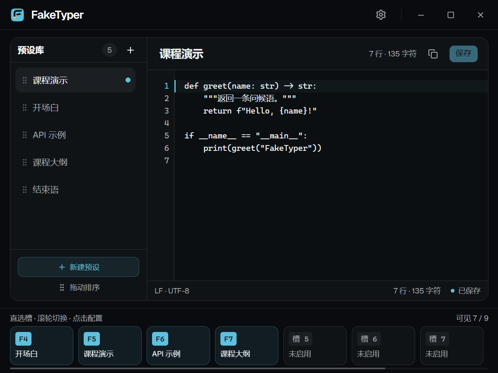
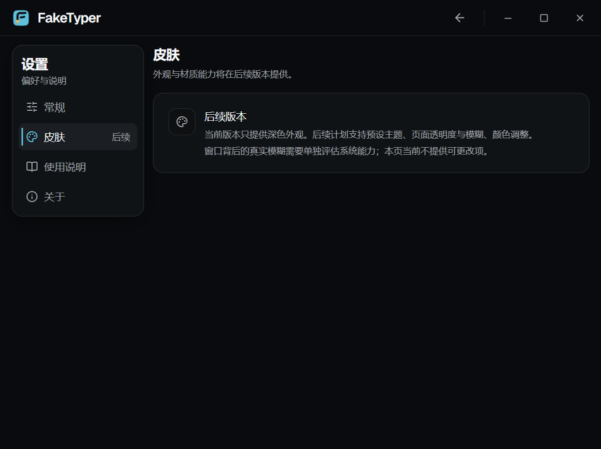
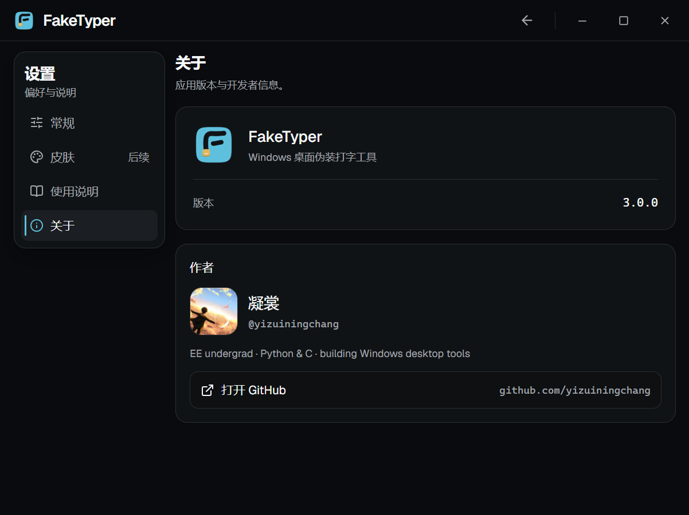
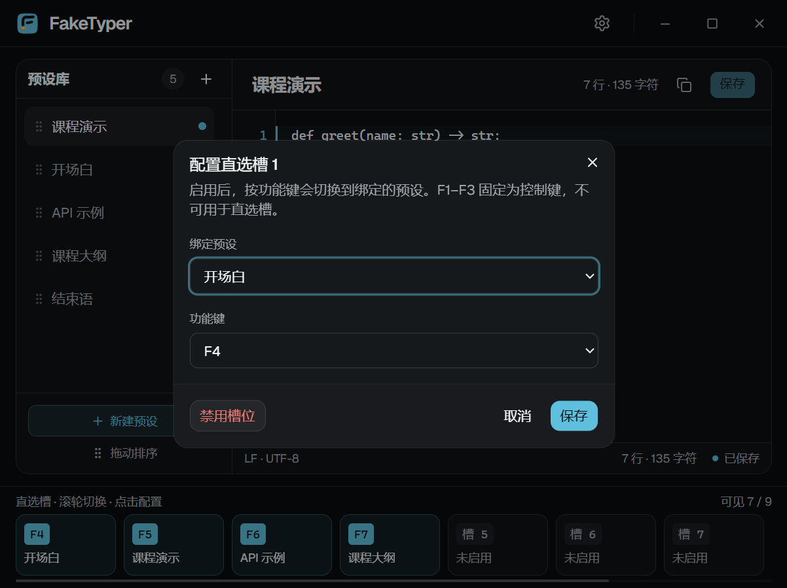
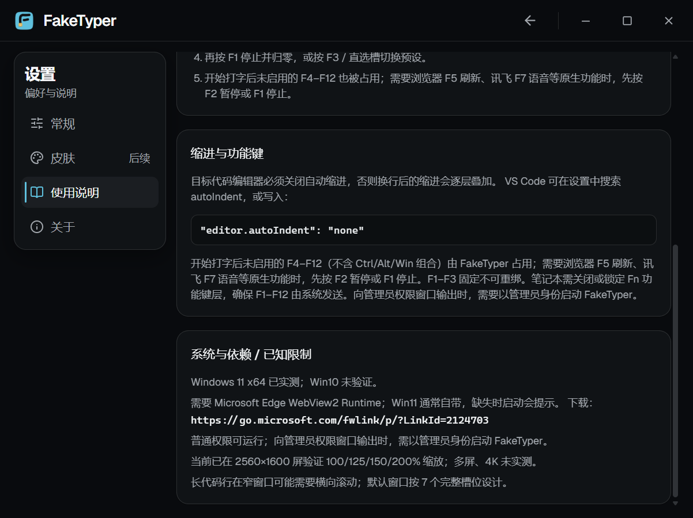

# FakeTyper V3

Windows 桌面“伪装打字”工具：你按键，程序按预设顺序逐字输出文本。
适合录课、直播、代码演示与现场 Demo——内容提前准备好，现场看起来像在手敲。

> 当前版本 **3.0.0**；Windows 11 x64 实机验证，Windows 10 未验证。  
> 下载：<https://github.com/yizuiningchang/FakeTyper/releases/latest>

  

## 功能

- **F1 / F2 / F3**：开始或停止（停止归零）、暂停或继续、切换下一个预设。
- **F4–F12 直选槽**：9 个逻辑槽，可为不同段落绑定功能键；运行时未启用的 F4–F12 会被占用，暂停或停止后恢复原生功能。
- **预设库**：新建、编辑、重命名、复制、删除、拖拽排序；逐键输出，不读写剪贴板。
- **编辑器式主界面**：左侧预设库、右侧标题与多行编辑区、底部直选槽；默认窗口按 7 个完整槽位设计。
- **自定义标题栏**：A1 品牌、同位置设置/返回、最小化/最大化/关闭；关闭窗口隐藏到托盘继续运行。
- **设置页**：常规、皮肤、使用说明、关于四个板块；左导航独立滚动，皮肤暂为静态占位。
- **托盘三态**：运行、暂停、待机各有独立图标；托盘菜单可切换预设、打开界面或退出。
- **单文件交付**：无需安装程序；单实例保护；WebView2 缺失时给出原生提示与下载地址。

## 快速开始

1. 从 [Releases](https://github.com/yizuiningchang/FakeTyper/releases/latest) 下载 `FakeTyper-3.0.0-win64.zip`，解压后运行 `FakeTyper.exe`。
2. 首次启动会创建“使用说明”预设并展开主界面。
3. 在预设库选择文本，按 **F1** 开始；之后按字母、数字、符号或空格输出下一个字符。
4. 需要修正时按 **F2** 暂停，键盘恢复原生输入；再按 **F1** 停止归零。
5. 关闭窗口只会隐藏到托盘；退出请使用托盘菜单“退出”。

数据目录：`%APPDATA%\FakeTyper`。升级前可自行备份；本版没有数据迁移步骤。

## 界面预览

| 设置 · 常规 | 设置 · 本地数据 |
| --- | --- |
|  |  |
| **皮肤** — 当前版本只提供深色外观，后续能力预留 | **关于** — 版本与作者信息 |
|  |  |

| 直选槽配置 | 使用说明 |
| --- | --- |
|  |  |

  

## 快捷键

| 按键 | 功能 |
|---|---|
| F1 | 开始 / 停止（停止后进度归零） |
| F2 | 暂停 / 继续（暂停时键盘恢复原生输入） |
| F3 | 切换到下一个预设 |
| F4–F12 | 直选槽；可在设置中启用、改键、绑定预设 |

> 运行态下，未启用或空出的 F4–F12（不含 Ctrl/Alt/Win 组合）由 FakeTyper 占用。需要浏览器 F5、讯飞 F7 等原生功能时，先按 F2 暂停或 F1 停止。

## 系统要求

- **Windows 11 x64**：已实测（10.0.26100 / 2560×1600）。
- **Windows 10 x64 22H2+**：目标平台，但 **Win10 未验证**；不宣称已支持。
- **Microsoft Edge WebView2 Runtime**：必需；Win11 通常自带，缺失时启动会显示提示与官方下载地址。
- 普通权限可运行；向管理员权限窗口输出时，需要以管理员身份启动 FakeTyper。
- 设计支持 1080P–4K / 100%–200% 缩放；已在 2560×1600 实机验证 100/125/150/200%。真实 4K、多显示器混合 DPI 未实测。

## 已知限制

- 目标代码编辑器需关闭自动缩进，否则换行缩进会逐层叠加。VS Code 可设置 `"editor.autoIndent": "none"`。
- 笔记本需关闭或锁定 Fn 媒体层，确保 F1–F12 由系统发送。
- 未做数字签名；Windows SmartScreen 可能提示，请核对来源与 SHA-256。
- Win10、真实 4K、多屏混合 DPI、任务栏缩略图/跳转列表、Snap Layouts 飞出层、触摸/触控笔未验证。
- 当前构建的“皮肤”仅静态占位；主题、透明度与模糊未实现。
- 长代码行在窄窗口可能需要横向滚动；默认窗口按 7 个完整槽位设计。

## 数据与隐私

- 应用运行期不发起网络请求，不读写剪贴板，不记录按键内容或预设文本。
- 数据仅保存在本机 `%APPDATA%\FakeTyper`。
- 关闭窗口隐藏到托盘；正常退出后释放键盘钩子。

## 关于本仓库

本仓库发布 **v3 单文件二进制**；v3 源码不公开。v1.0.0 / v1.0.1 是历史版本，保留在 tags 中。

## 许可

[PolyForm Noncommercial License 1.0.0](LICENSE)。仅供非商业用途；商业使用需另行获得许可。

## 作者

凝裳（[@yizuiningchang](https://github.com/yizuiningchang)）· FakeTyper 作者
